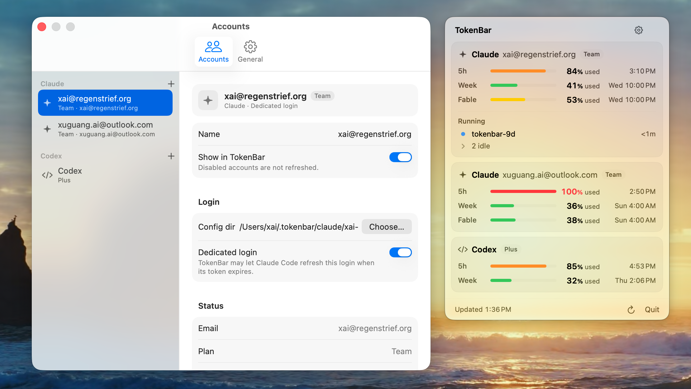
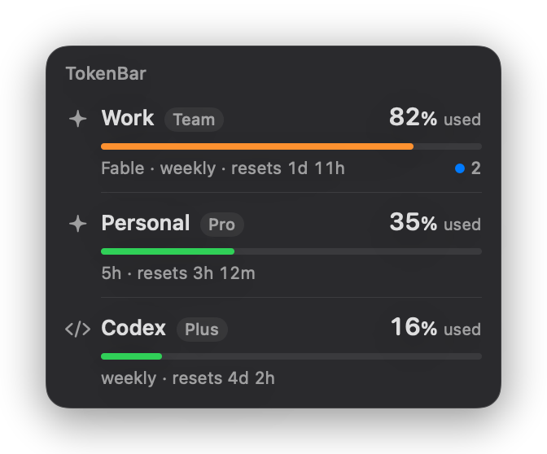

# TokenBar

**Claude Code and Codex usage limits, right in your Mac's menu bar.**


Claude and ChatGPT plans cap how much you can use in a 5-hour window and over a week, and some models have a weekly
cap of their own. TokenBar shows how much of each limit you have used and when it resets, for several accounts at
once, along with the Claude Code sessions that are running right now.



## Features

- **Every account at a glance.** Several Claude accounts (for example, work and personal) plus Codex, each with its
  5-hour, weekly and model limits and their reset times.
- **A menu bar number that follows you.** It shows the 5-hour usage of the Claude account you are working in, and
  follows along when you switch with `/login`. You can also pin it to one account.
- **Running sessions.** See which Claude Code sessions are busy, and for how long, under the account they run on.
- **A floating window.** Click the number to open it. It stays on top on every Space, never takes focus, and uses
  Liquid Glass on macOS 26.
- **Uses none of your quota.** Reading your usage makes no model calls, so it doesn't count against your limits.
- **Careful with your logins.** TokenBar never refreshes, copies or stores your tokens, and only runs `claude` and
  `codex` binaries signed by Anthropic and OpenAI. See [Privacy and security](#privacy-and-security).
- **A command-line tool.** `tokenbar status` and `tokenbar sessions`, with JSON output for scripts.

## Requirements

- macOS 14 or later.
- Swift 6.2 or later, from Xcode 26 or just the Command Line Tools (`xcode-select --install`). Check with
  `swift --version`.
- **For Claude:** Claude Code, signed in with a Claude plan such as Pro, Max or Team. (Logins with an API key have no
  plan limits to show.) Version 2.1.289 or later is recommended: older versions can't renew
  [dedicated logins](#several-claude-accounts) and may not report running sessions.
- **For Codex:** the Codex CLI, or the ChatGPT extension for VS Code, Cursor or Windsurf, signed in with your
  ChatGPT account.

## Install

There's no prebuilt download yet, but building takes only about a minute:

```bash
git clone https://github.com/xuguang-ai/TokenBar.git
cd TokenBar
scripts/bundle.sh    # builds dist/TokenBar.app
scripts/install.sh   # copies it to ~/Applications and starts it
```

TokenBar has no Dock icon. Look for a percentage such as `42%` in the menu bar and click it. If you can't find it,
see [Troubleshooting](#troubleshooting).

**To update**, run `git pull` and then both scripts again.

**To uninstall:**

1. Right-click the number and choose **Quit TokenBar**.
2. Delete `~/Applications/TokenBar.app`.
3. If you want, also delete TokenBar's data: `~/Library/Application Support/TokenBar` (settings and cached numbers)
   and `~/.tokenbar` (dedicated logins). A dedicated login also leaves a Claude Code Keychain item; to remove it,
   run `CLAUDE_CONFIG_DIR=<folder> claude`, use `/logout`, and then delete the folder.

## Set up your accounts

TokenBar starts with two cards. **Claude** reads the login in `~/.claude`, which is the account you last chose with
`/login`. **Codex** reads `~/.codex`. If you have one Claude account, there is nothing to set up.

### Several Claude accounts

`~/.claude` holds one login at a time. To see more accounts, give each one a **dedicated login**: a separate folder
that only TokenBar reads, which you sign in to once.

1. Open the TokenBar window, click ⚙ → **Accounts**, then `+` → **Add Dedicated Login…**
2. Enter a name such as `Work`. TokenBar creates `~/.tokenbar/claude/work` and shows the login command.
3. Click **Open in Terminal** (or copy the command into a terminal) and sign in in the browser.
4. TokenBar notices the finished login within a few seconds and starts showing the account.
5. Repeat for each account. After the first one, TokenBar offers to turn off the default Claude card, so that the
   same account is not shown twice.

> [!IMPORTANT]
> The browser signs in with whichever claude.ai account it is already logged in to. Before step 3, sign out of
> claude.ai, or open the login link in a private window, and check the account on the consent page. Otherwise two
> cards end up showing the same account.

You keep using `~/.claude` and `/login` as before. Dedicated logins look after themselves: when a token expires,
TokenBar asks Claude Code to renew it by running `claude -p "/usage"` in that folder, a local command that makes no
model call. You can turn this off in Settings › General › Advanced.

The `+` menu also has **Add Account with Config Dir…** for a `CLAUDE_CONFIG_DIR` you already use, and
**Add Codex Account** and **Add Account with CODEX_HOME…** for more Codex profiles.

## Using TokenBar

### The menu bar

- **Click** the number to open or close the TokenBar window. **Right-click** it (or Control-click) for
  **Refresh**, **Settings…** and **Quit TokenBar**.
- Hover over the number to see which account and limit it shows. The icon turns into a warning when any limit of
  that account is nearly used up, even if its 5-hour window is fine.
- Settings › General › **Menu bar shows** chooses the account:
  - **Active Claude account** (the default): the account `~/.claude` is logged in to. After a `/login`, the number
    catches up within 30 seconds, or within 3 seconds while the window is open. If TokenBar has no card for that
    account, it shows the most constrained account instead.
  - **Most constrained account**: whichever account is closest to one of its limits, showing that limit.
  - Any single account, showing its 5-hour usage.

| You see | It means |
| --- | --- |
| `42%` | The usage of the account chosen above. |
| `42%?` | The number is out of date, or the last refresh failed. |
| `!` | The last refresh failed, and there is no data. |
| `–` | There is no data yet. |

### The TokenBar window

<p align="center">
  
</p>

- Each account has a card, with a row for each limit: a progress bar, the percentage used and the reset time. To
  see what's left instead, change Settings › General › **Show percentages as**.
- Reset times show as clock times (`Wed 11:00 PM`) or as countdowns (`1d 12h`); choose in Settings › General ›
  **Reset times**. Hover over a reset time to see the other format.
- Bar colors show what's left: green above 50%, yellow from 20% to 50%, orange from 5% to 20%, and red below 5% or
  once a limit is reached.
- When something needs your attention, a card adds a status line. Examples are numbers that come from a cache, a
  pause because of rate limiting, and `Not logged in` with the login command and a Copy button.
- Claude cards list the running Claude Code sessions: busy ones with their duration, and idle ones folded into an
  "N idle" row that you can expand.
- The window stays above other windows on every Space and never takes focus. Drag it anywhere, and it remembers the
  spot. To close it, click the number again, or use the ✕ that appears when you point at the window. If you leave it
  open, it opens again the next time TokenBar starts.

### Settings

- **Accounts:** add, remove, rename and reorder accounts (drag them), hide an account without removing it, change
  its config folder or `CODEX_HOME`, and see the email and plan it is signed in with.
- **General:** the refresh interval, used or left, the reset time format, what the menu bar shows, launch at login,
  whether Claude Code may renew dedicated logins, a proxy for the `claude` and `codex` processes, and custom paths
  to `claude` and `codex`.

### When it refreshes

Every 5 minutes by default. You can choose anything from 1 to 30 minutes, but Codex is checked at most every 5
minutes. TokenBar also refreshes when it starts, 10 seconds after the Mac wakes, when settings change, and when you
click **Refresh**. If a refresh fails, you keep the last good numbers, with the time they were updated.

Claude Code checks the same usage endpoint, and Anthropic rate-limits it. So TokenBar reuses Claude Code's numbers
when they are newer than its own. If Anthropic still answers with a rate limit, TokenBar waits before asking again,
starting at 5 minutes and doubling up to an hour.

## Command line

The command-line tool is built separately. Run `swift build -c release --product tokenbar`, then copy
`.build/release/tokenbar` to a folder on your `PATH`.

```bash
tokenbar status                 # a table of every account
tokenbar status --json          # the same, as JSON
tokenbar status --account Work  # only some accounts (repeatable)
tokenbar sessions [--json]      # running Claude Code sessions
```

Example output, with **Reset times** set to Countdown:

```text
Claude · Work  Max
  5h      ███████░░░   68% used  2h 14m
  Week    ██░░░░░░░░   20% used  3d 4h
  Sonnet  █░░░░░░░░░    8% used  3d 4h

Codex  Plus
  5h      ░░░░░░░░░░    0% used  not started
  Week    ██░░░░░░░░   16% used  6d 17h
```

- `tokenbar` uses the app's accounts and settings, which it reads but never changes. Without the app, it uses the
  defaults.
- Like the app's **Refresh** button, `tokenbar status` always asks for fresh numbers, but it respects a rate-limit
  pause that is already in effect.
- It doesn't let Claude Code renew an expired dedicated login unless you add `--allow-claude-refresh`, because
  pressing Ctrl-C could interrupt Claude Code in the middle of renewing.
- Exit codes: `0` when every account succeeded, `1` when at least one failed (whatever could be fetched is still
  printed), and `2` for a configuration or usage error.

## Privacy and security

**In short:** TokenBar only reads. It never refreshes, copies or stores your tokens, and the only address it
contacts is Anthropic's usage endpoint. The details:

- **Claude.** TokenBar reads the access token from the Keychain item that Claude Code created, using
  `/usr/bin/security` as Claude Code does. The token stays in memory for one request to
  `https://api.anthropic.com/api/oauth/usage`, the endpoint Claude Code uses for `/usage`. The request goes over an
  ephemeral connection that has no cache and refuses redirects. The token is never written anywhere.
- **Your logins stay yours.** TokenBar never calls the OAuth refresh endpoint, and never writes to `~/.claude`,
  `~/.claude.json`, `~/.codex` or the Keychain. Renewing tokens is left to Claude Code, and only for dedicated logins,
  so TokenBar cannot sign out your everyday Claude Code by rotating its token.
- **Claude Code's config file.** From `~/.claude.json` (or a dedicated login's copy), TokenBar reads only
  `oauthAccount`, which says who is signed in, and `cachedUsageUtilization`, Claude Code's last usage numbers. Every
  other key, including MCP server settings that can hold secrets, is ignored: never stored, logged or shown.
- **Codex.** TokenBar starts OpenAI's `codex app-server` and asks it only for the account and its rate limits,
  through an allowlist of JSON-RPC methods. It never sees the Codex token. If the app server is unavailable, it reads
  the latest rate-limit snapshot from the end of Codex's session logs in `~/.codex/sessions`.
- **Signed binaries only.** `claude` must be signed by Anthropic (Team ID `Q6L2SF6YDW`) and `codex` by OpenAI
  (`2DC432GLL2`). These processes get a minimal environment (home, user, `PATH`, temporary folder and an optional
  proxy), so API keys set in your shell cannot change which account they use.
- **No other network traffic.** The `claude` and `codex` processes that TokenBar starts talk to their own services.
  TokenBar itself sends no telemetry and doesn't check for updates.
- **Local files.** Settings, the last usage numbers (without emails) and rate-limit state are kept in
  `~/Library/Application Support/TokenBar/`, with files at mode `0600` and the folder at `0700`. Dedicated logins live
  in `~/.tokenbar/claude/`, also at `0700`.

## Troubleshooting

- **There's no number in the menu bar.** On a MacBook with a notch, menu bar items that don't fit to the right of the
  notch are hidden. A newly started app's item goes furthest to the left, so it is the first to disappear. Quit a few
  menu bar apps, or hide some items in System Settings (Menu Bar on macOS 26, Control Center before that), until
  TokenBar appears. Then hold ⌘ and drag it toward the clock, where it stays visible.
- **The build fails with "You have not agreed to the Xcode license agreements".** The scripts switch to the Command
  Line Tools on their own when those are installed. Otherwise, install them with `xcode-select --install`, or accept
  the license with `sudo xcodebuild -license`. For a plain `swift build`, put
  `DEVELOPER_DIR=/Library/Developer/CommandLineTools` in front of it.
- **Two Claude cards show the same numbers.** One dedicated login was signed in with the other account, usually
  because the browser was already logged in to it. Sign that login in again from a private browser window:

  ```bash
  env -u CLAUDE_SECURESTORAGE_CONFIG_DIR -u CLAUDE_CODE_CUSTOM_OAUTH_URL \
    CLAUDE_CONFIG_DIR="$HOME/.tokenbar/claude/work" claude auth login
  ```

  Use the config folder shown in Settings › Accounts, exactly as shown and without a trailing slash, because Claude
  Code derives the Keychain item's name from it. Then click **Refresh**.
- **"Anthropic is rate-limiting usage checks".** The usage endpoint is rate-limited, and Claude Code uses it too.
  TokenBar keeps the last numbers and tries again by itself; the card shows when.
- **"Waiting for Claude Code to refresh".** The login's access token has expired. For the default `~/.claude` login,
  use Claude Code once and it renews its token. Dedicated logins are renewed in the background, unless you turned
  that off in Settings › General › Advanced.
- **"Keychain access denied".** macOS refused, or is still asking for, access to Claude Code's Keychain item.
  TokenBar shows cached numbers in the meantime. Click **Refresh** to try again, and allow access if macOS asks.
- **Launch at login doesn't stick.** It needs the app in `/Applications` or `~/Applications` (`scripts/install.sh`
  puts it there), and macOS may ask you to approve TokenBar in System Settings › General › Login Items.

## Contributing

Bug reports and pull requests are welcome. Before you send a pull request, run the tests, and for changes to the
interface, the selftest too:

```bash
scripts/test.sh                          # the swift-testing suite
scripts/test.sh --filter ClaudeProvider  # a subset
scripts/bundle.sh && dist/TokenBar.app/Contents/MacOS/TokenBar --selftest  # UI selftest with stub data
dist/TokenBar.app/Contents/MacOS/TokenBar --render-floating /tmp/previews  # PNG previews; also --render-panel, --render-settings
scripts/probe-claude-usage.sh            # call the usage endpoint once and print only the numbers
```

- Run the tests with `scripts/test.sh` rather than `swift test`. With only the Command Line Tools installed, plain
  `swift test` cannot find the Testing framework and can exit successfully without running a single test.
- The selftest drives the real interface with stub data and a temporary home folder. It doesn't touch the Keychain,
  the network or your settings, and prints `SELFTEST PASS`.
- Layout:
  - `Sources/TokenBarCore`: everything except the interface, including the Claude and Codex providers, refresh
    scheduling, the session monitor, the stores and the command-line logic.
  - `Sources/TokenBarCLI`: the `tokenbar` executable.
  - `Sources/TokenBarApp`: the SwiftUI and AppKit app.
  - `Tests/TokenBarCoreTests`: tests and fixtures.
- In `TokenBarCore`, the clock, files, processes, network and code-signature checks all go through
  `CoreEnvironment`, so tests can replace them. `scripts/test.sh` fails if code outside `Live*.swift` calls these
  APIs directly.

## Disclaimer

TokenBar is an independent project. It is not affiliated with or endorsed by Anthropic or OpenAI. It reads usage
through interfaces that Claude Code and Codex use internally, including an undocumented Anthropic endpoint, and
these can change without notice. Claude is a trademark of Anthropic, PBC. Codex and ChatGPT are trademarks of OpenAI.

## License

TokenBar is released under the [MIT License](LICENSE).
